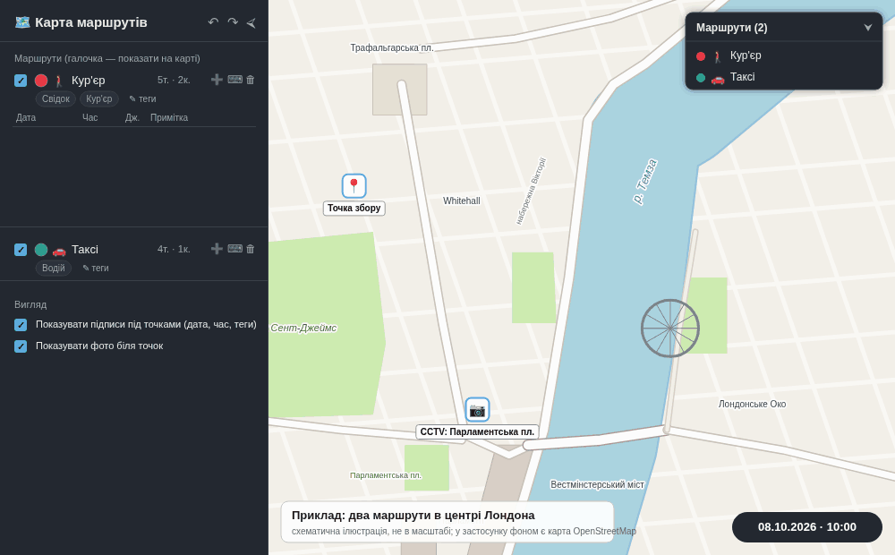

# route-map

Безкоштовний, повністю клієнтський інструмент для нанесення на карту власних маршрутів руху пішоходів/авто з точками фіксації, часовими мітками, фото та окремими мітками-орієнтирами. Працює на [OpenStreetMap](https://www.openstreetmap.org/) + [Leaflet](https://leafletjs.com/) — без платних API-ключів. Відкривається прямо з файлу (`index.html`) або як сайт на GitHub Pages.

## Приклад



*Приклад: два маршрути в центрі Лондона (пішохід і таксі) з колінами, фото біля точки та окремими мітками. Це схематична ілюстрація, а в самому застосунку фоном слугує карта OpenStreetMap.*

Щоб відтворити цей приклад: відкрийте застосунок, натисніть «📂 Завантажити JSON» і оберіть [`examples/london-route.json`](examples/london-route.json).

## Можливості

**Маршрути**
- Створення маршрутів: назва, тип (🚶 пішохід / 🚗 авто), колір (можна змінити пізніше), довільні теги (Свідок, Кур'єр, ...)
- Точки фіксації: дата, час, джерело (📹 відеокамера / 🎥 відеореєстратор / 📍 інше), примітка, фото або скан
- Лінія маршруту зі стрілками напрямку кольору маршруту
- «Коліна» для кривих вулиць — **клік прямо по лінії маршруту** (без окремого режиму, як у Google My Maps): на лінії з'являється точка вигину, її перетягують мишею. Кожне нове коліно вставляється в найближчий відрізок реальної лінії, тож навіть вулиці з різкими вигинами малюються в правильному порядку. Видалити коліно — клік по ньому → «видалити». (Поки ввімкнений режим додавання точок, клік по лінії додає точку — спершу натисніть «Готово».)
- **Права кнопка миші по лінії маршруту** відкриває меню цього маршруту: «📍 Додати точку тут» (точка ставиться точно на лінію, а час підставляється пропорційно між сусідніми точками — посередині між 10:00 і 10:10 буде 10:05; його можна змінити), «📐 Додати коліно» (працює й тоді, коли ввімкнено режим додавання точок) «⇄ Реверс напрямку» (час точок перекладається у зворотному порядку, тож маршрут іде в інший бік і стрілки змінюються; перед цим застосунок питає підтвердження, а Ctrl+Z повертає все назад) та «↩ Дорога назад…» — створює новий маршрут іншого кольору з тими самими точками у зворотному порядку (з підписами, джерелами, тегами та формою лінії; фото не копіюються). Для нього відкривається вікно зі списком усіх точок, де вказують дату й час кожної (або задають час початку й натискають «Заповнити» — тоді збережуться ті самі інтервали, що й на шляху туди). Новий маршрут малюється пунктиром, щоб обидва маршрути, які йдуть однією дорогою, було видно. Додавання точки чи коліна через ПКМ одразу вимикає режим додавання точок, тож подальші кліки по карті нічого не додають.
- **Права кнопка миші по порожньому місцю карти** — «🗑 Очистити карту…»: видаляє всі маршрути, точки, коліна, фото й мітки (спершу застосунок показує, скільки саме буде видалено, і просить підтвердження; Ctrl+Z повертає все назад; збережені в браузері плани не зачіпаються)
- Перетягування точок і колін мишею для уточнення координат
- **Скасування й повтор** — Ctrl+Z, Ctrl+Y (або Ctrl+Shift+Z; працює й на українській розкладці) та кнопки ↶ ↷ у шапці панелі. Скасовується все, що змінює дані: точки, коліна, маршрути, теги, кольори, фото, мітки, імпорт, завантаження плану; швидкі серії змін (напр. вибір кольору) зливаються в один крок, пам'ять — до 100 кроків. Історія не зберігається між перезавантаженнями сторінки
- Редагування вже доданих точок (не тільки видалення)
- Кластеризація точок на карті при зменшенні масштабу (Leaflet.markercluster)
- Постійні підписи під точками (дата/час/теги) — вмикаються галочкою
- Галочки показу/приховування кожного маршруту, «Показати всі» / «Сховати всі»

**Фото біля точок**
- Фото/скан, прикріплене до точки, показується на карті у вигляді картки, з'єднаної з точкою лінією
- Картку можна перетягувати куди завгодно й змінювати її розмір за кутовий маркер ↘ — лінія зв'язку з точкою не втрачається; положення й розмір зберігаються
- ✕ на картці ховає її; повернути — через «🖼» у таблиці точок або посилання у спливаючому вікні точки; галочка «Показувати фото біля точок» керує всіма картками одразу
- Фото додається через Ctrl+V (будь-де у вікні точки), кнопку «Обрати файл» або посилання; великі зображення автоматично зменшуються (до 1280 px, JPEG), щоб не роздувати збереження й `routes.json`

**Окремі мітки на карті**
- Будинок, Автомобіль, Підозрювана особа, Небезпечний об'єкт, Камера спостереження та інші — ставляться кліком по карті, підписуються, перетягуються
- Підписи під мітками — вмикаються окремою галочкою

**Введення даних**
- Додавання точки кліком по карті або вручну за координатами
- Вставка координат із буфера обміну (Ctrl+V або кнопка 📋) в будь-якому зручному форматі
- Масовий імпорт точок — вставте CSV або скопійований з Excel/Google Таблиць текст (колонки: Маршрут, Тип, Дата, Час, Широта, Довгота, Джерело, Примітка)

**Збереження**
- 💾 Автоматичне збереження в IndexedDB цього браузера — дані не губляться після перезавантаження сторінки
- Іменовані «плани» в браузері (План 1, План 2, ...) для порівняння сценаріїв
- 💾 Експорт/📂 імпорт у `routes.json` — для перенесення роботи на інший комп'ютер

**Звітність**
- 📊 Експорт у CSV (відкривається в Excel; Word теж імпортує CSV як таблицю)
- 🖨 Друк / збереження в PDF з автоматичною легендою маршрутів
- 📝 **Звіт у Word (.docx)** для долучення до справи: знімок карти з усіма показаними маршрутами (лінії, стрілки напрямку, коліна, пронумеровані точки, мітки М1, М2…), таблиця маршрутів, таблиці точок кожного маршруту (№, дата, час, координати, джерело, примітка), таблиця міток та мініатюри фото/сканів із підписами. Номери на карті збігаються з колонкою «№» у таблицях. У звіт потрапляють маршрути, позначені галочкою. Для створення потрібен інтернет (бібліотека `docx` підвантажується з CDN лише при натисканні кнопки; фон карти — тайли OpenStreetMap, без мережі звіт формується із сірим тлом)

**Інтерфейс**
- Бічна панель згортається до вузької іконки одним кліком
- Компактна легенда маршрутів прямо на карті (окремо від повної бічної панелі), теж згортається

## Як користуватись

Відкрийте `index.html` прямо з файлу — усе працює локально, крім завантаження тайлів карти (потрібен інтернет). Для роботи на кількох комп'ютерах використовуйте 💾 «Зберегти JSON» / 📂 «Завантажити JSON».

## GitHub Pages

Репозиторій налаштований для GitHub Pages — сайт доступний за адресою цього репозиторію (Settings → Pages). Якщо в корені репозиторію лежить `routes.json`, сторінка підвантажить його автоматично при відкритті через https (на звичайному локальному файлі — ні, там працює лише ручне «Завантажити JSON»).

## Якщо щось не працює

Якщо вгорі сторінки з'явилась **червона смуга** — один або кілька файлів `js/*.js` завантажено неправильно: назва не збігається точно (наприклад `js/poi` замість `js/poi.js`) або всередині лежить код іншого файлу. Смуга називає проблемні файли; після виправлення оновіть сторінку (Ctrl+F5, щоб браузер не брав стару копію з кешу).

Якщо під час роботи щось пішло не так, унизу ліворуч з'являється **червоне повідомлення** з текстом помилки (✕ закриває його) — скопіюйте його разом з описом кроків, що до цього привели. Дані при цьому не втрачаються: поточна робота постійно зберігається в браузері, і після перезавантаження сторінки (F5) вона на місці.

## Тести

У папці `tests/` лежать автоматичні перевірки (понад 230): вони відкривають застосунок у справжньому браузері (Chromium через Playwright) і проходять по основних сценаріях — маршрути, коліна, точки, меню правої кнопки, «Дорога назад», «Очистити карту», скасування/повтор, імпорт, звіт у Word, приклад. Окремий набір без браузера перевіряє самі файли проєкту (назви, повторне `const App`, id в HTML тощо) — саме такі помилки трапляються при ручному заливанні файлів на GitHub.

```
cd tests
npm install            # один раз: Playwright і бібліотека docx
npm run setup          # один раз: завантажити браузер Chromium
npm test               # усі набори;  npm test -- bends  — лише ті, що містять «bends» у назві
```

Важливо: замість справжньої карти в тестах стоїть її спрощена заміна (`tests/fake-leaflet.js`), тож вони перевіряють логіку застосунку, а не саму бібліотеку Leaflet. Тому після великих змін варто один раз переглянути роботу на живій карті. Тести не потрібні для роботи сайту — GitHub Pages їх просто ігнорує.

## Структура проєкту

```
index.html         розмітка сторінки + самоперевірка завантаження модулів
styles.css          вся стилізація
js/
  constants.js      типи джерел фіксації, теги-підказки, типи міток (єдиний файл із `const App`)
  state.js          дані застосунку (маршрути, точки, мітки) + допоміжні функції
  map.js            карта Leaflet: кластеризація, малювання маршрутів, коліна
  photo-cards.js    фото-картки біля точок: перетягування, розмір, лінія зв'язку
  context-menu.js    меню правої кнопки миші (лінія маршруту, порожнє місце карти)
  return-trip.js    «Дорога назад»: вікно з датами/часом і створення зворотного маршруту
  poi.js            окремі мітки на карті (Будинок/Авто/...)
  sidebar.js        бічна панель, список маршрутів, теги, колір
  point-modal.js     вікно додавання/редагування точки, вставка координат і фото
  bulk-import.js     масовий імпорт точок з CSV/Excel
  legend.js          компактна легенда маршрутів на карті
  storage.js         IndexedDB: автозбереження та іменовані плани
  history.js         скасування/повтор (Ctrl+Z / Ctrl+Y)
  export.js          JSON, CSV, друк/PDF
  report.js          звіт у Word: знімок карти, таблиці, фото
  main.js            запуск застосунку
```

```
tests/             автоматичні тести (див. нижче)
docs/
  london-route.gif   анімований приклад для цього README
  london-route.png   те саме, нерухомий кадр
examples/
  london-route.json  приклад даних: завантажується кнопкою «Завантажити JSON»
```

Кожен файл і логічний блок у ньому супроводжується коментарем, що він робить.
